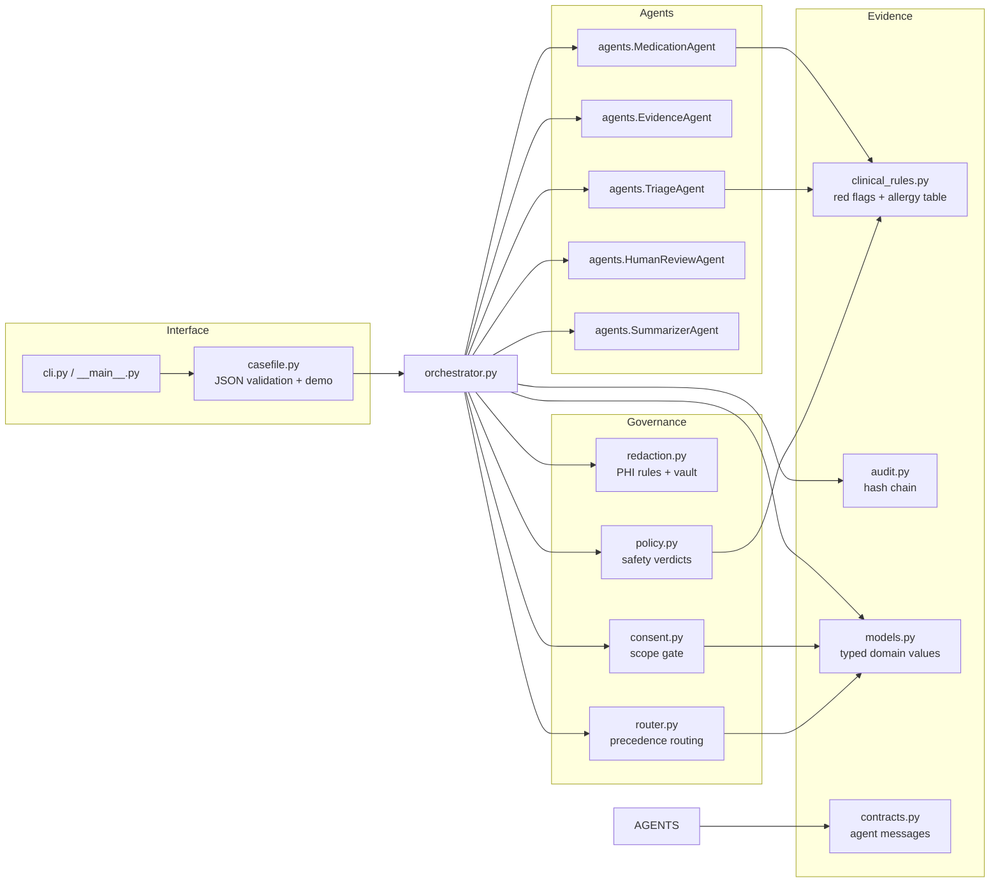
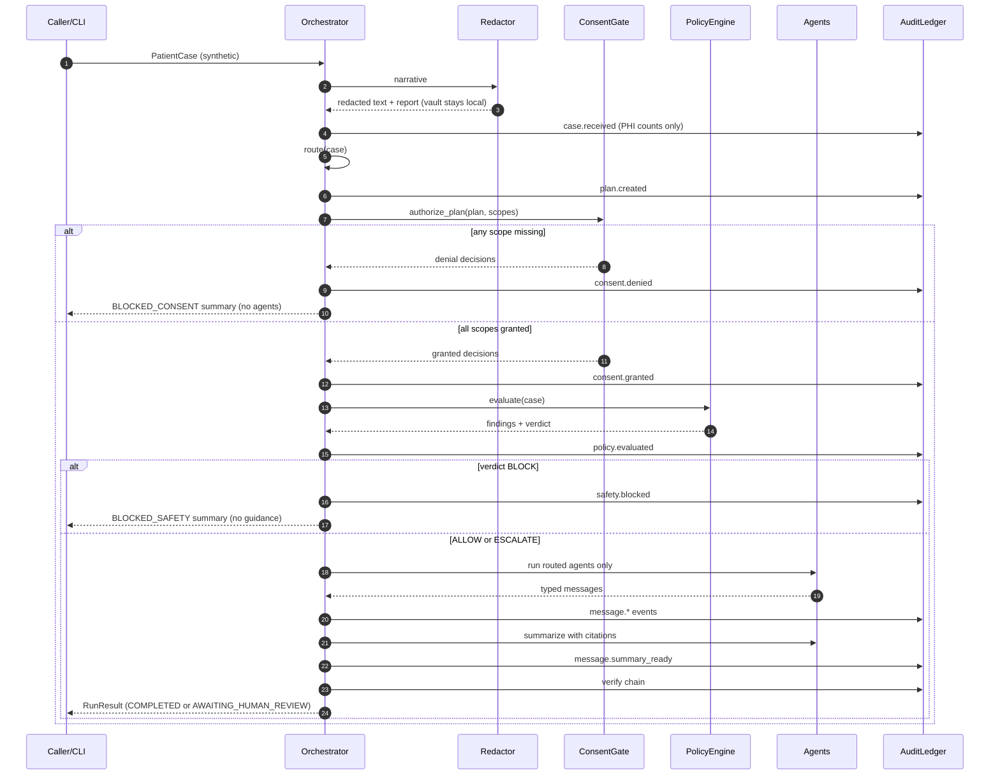
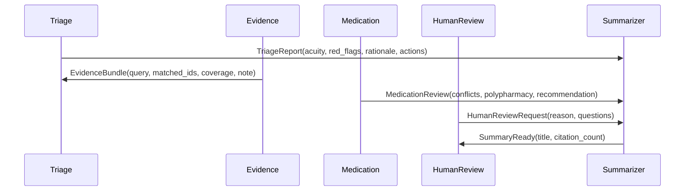

# Architecture

> **Research prototype.** Synthetic data only. Not a medical device, not clinical
> decision support, and not validated for care delivery.

## 1. Design goals

1. **Deterministic governance.** The same synthetic case produces the same route,
   findings, tokens, and audit hashes (given a fixed clock).
2. **Fail closed.** Missing consent or a medication conflict stops the workflow
   before clinical guidance is produced.
3. **Auditability.** Every control decision is an event in a hash-chained ledger.
4. **Zero runtime dependencies.** Python 3.10+ standard library only.
5. **Offline by construction.** No network, model provider, API key, or database in
   the tested path.
6. **Typed boundaries.** Agents exchange frozen dataclass payloads, not free-form
   dictionaries.

### Non-goals

- Clinical accuracy or diagnostic performance.
- Real patient intake, EHR integration, or FHIR interoperability.
- Complete de-identification or regulatory compliance.
- Production-grade distributed audit storage.
- LLM quality evaluation.

## 2. Component map



## 3. Module responsibilities

| Module | Responsibility | Key public API |
|---|---|---|
| `ieesbots/models.py` | Enums and immutable domain values: cases, flags, routing, policy, summaries, audit entries, run results | `PatientCase`, `CaseFlags`, `RoutingPlan`, `PolicyAssessment`, `Summary`, `RunResult` |
| `ieesbots/contracts.py` | Typed inter-agent message envelopes and payloads | `AgentMessage`, `TriageReport`, `EvidenceBundle`, `MedicationReview`, `HumanReviewRequest`, `SummaryReady` |
| `ieesbots/clinical_rules.py` | Small deterministic rule primitives | `matching_red_flags`, `allergy_conflicts`, `is_polypharmacy` |
| `ieesbots/redaction.py` | Regex PHI removal, stable tokens, local vault, detokenization | `Redactor`, `PhiVault`, `RedactionResult` |
| `ieesbots/router.py` | Pure routing from structured flags and fields | `AgentRouter.route` |
| `ieesbots/consent.py` | Scope-per-role authorization decisions | `ConsentGate.authorize_plan` |
| `ieesbots/policy.py` | Rule composition and `BLOCK > ESCALATE > ALLOW` precedence | `SafetyPolicyEngine.evaluate` |
| `ieesbots/audit.py` | SHA-256 hash-chained event ledger | `AuditLedger.append`, `verify`, `verify_or_raise` |
| `ieesbots/agents.py` | Deterministic agent behavior and cited summary composition | `TriageAgent`, `EvidenceAgent`, `MedicationAgent`, `HumanReviewAgent`, `SummarizerAgent` |
| `ieesbots/orchestrator.py` | Fixed governance control order and blocked paths | `Orchestrator.run` |
| `ieesbots/casefile.py` | JSON schema validation and synthetic demo case | `case_from_dict`, `load_case`, `demo_case` |
| `ieesbots/cli.py` | Text/JSON output and exit codes | `main`, `build_parser`, `render_result` |
| `ieesbots/exceptions.py` | Package-specific exception hierarchy | `CaseValidationError`, `ConsentDeniedError`, `PolicyViolationError`, `AuditIntegrityError` |

## 4. Control order

`Orchestrator.run` enforces this order. It is a safety property, not an
implementation detail.



### Terminal statuses

| Status | Meaning |
|---|---|
| `COMPLETED` | Policy `ALLOW`; a cited draft was produced; no human escalation required by policy |
| `AWAITING_HUMAN_REVIEW` | Policy `ESCALATE`; draft produced but explicitly not final |
| `BLOCKED_CONSENT` | A required scope was missing; no agent ran, no policy findings |
| `BLOCKED_SAFETY` | Policy `BLOCK`; no agent ran, no clinical guidance produced |

The CLI maps terminal statuses to exit codes: `0` for completed/awaiting review,
`1` for blocked, `2` for invalid input.

## 5. Routing precedence

The router is a pure function. Lower priority numbers execute first. All matching
rules contribute; they are not mutually exclusive.

| Priority | Role | Trigger(s) | Required scope |
|---:|---|---|---|
| 10 | Triage | Always | `care.triage` |
| 20 | Evidence | Imaging available **or** chest-pain flag **or** an evidence bundle was supplied | `evidence.retrieve` |
| 30 | Medication | Polypharmacy flag **or** ≥2 medications **or** any allergy recorded | `medication.review` |
| 40 | Human review | Chest pain **or** mental-health crisis **or** pregnancy **or** pediatric flag **or** age ≥75 | `human.review` |
| 90 | Summarizer | Always | `summary.generate` |

Each decision stores a human-readable rationale string. Multiple triggers are
joined with `; `, e.g. *"Polypharmacy flag is set; Multiple medications require
interaction review"*. This makes route changes reviewable in a diff and in audit.

**Why these triggers:** chest pain and pregnancy change imaging/medication risk;
polypharmacy needs a pharmacist; age and pediatric status change dosing; mental
health crisis needs immediate human support. These are illustrative rules, not
clinical guidance.

## 6. Safety policy

### Rule table

| Rule | Category | Trigger | Severity | Verdict |
|---|---|---|---|---|
| `RF-001` | red flag | "chest pain" in symptoms or `chest_pain` flag | critical | `ESCALATE` |
| `RF-002` | red flag | "shortness of breath" | high | `ESCALATE` |
| `RF-003` | red flag | "suicidal" or `mental_health_crisis` flag | critical | `ESCALATE` |
| `RF-004` | red flag | "stroke" | critical | `ESCALATE` |
| `RF-005` | red flag | "severe bleeding" | critical | `ESCALATE` |
| `ALG-001` | allergy | Allergy/medication containment or shared illustrative drug family | critical | `BLOCK` |
| `EVD-001` | missing evidence | Any red flag **and** no evidence bundle | high | `ESCALATE` |
| `MED-001` | polypharmacy | `polypharmacy` flag or ≥5 medications | high | `ESCALATE` |
| `PED-001` | pediatric | `pediatric` flag or age <18 | moderate | `ESCALATE` |
| `PRG-001` | pregnancy | `pregnancy` flag | high | `ESCALATE` |

### Verdict precedence

```text
if any finding == BLOCK       -> BLOCK
elif any finding == ESCALATE  -> ESCALATE
else                          -> ALLOW
```

Any non-empty finding requires a human reviewer (`requires_human=True`). The
summarizer records the verdict and findings; the orchestrator sets
`AWAITING_HUMAN_REVIEW` when human review is required or `COMPLETED` otherwise.

### Allergy matching

Names are normalized (trim + lowercase). A conflict exists when:

- the allergy string is contained in the medication string,
- the medication string is contained in the allergy string, or
- both appear in the same illustrative family in `ALLERGY_FAMILIES`.

This is intentionally over-inclusive: ambiguous cases block and escalate rather
than risk an unsafe recommendation.

## 7. PHI redaction

Patterns execute in this order (from `DEFAULT_PATTERNS`):

| Kind | Example matched | Token |
|---|---|---|
| `email` | `jane.synthetic@example.test` | `[[EMAIL_1]]` |
| `mrn` | `MRN: 8891234`, `MRN-123456` | `[[MRN_1]]` |
| `ssn` | `123-45-6789` | `[[SSN_1]]` |
| `phone` | `(555) 010-2030`, `555-123-4567` | `[[PHONE_1]]` |
| `date` | `2026-01-15`, `1/2/2025` | `[[DATE_1]]` |

Properties:

- Repeated values receive the same token.
- The vault maps token → original in memory only.
- `detokenize` reverses known tokens and leaves unknown tokens untouched.
- The report contains per-kind counts and a total.
- `RunResult` and JSON output expose **tokens and counts only**, never vault contents.

## 8. Audit chain

For each entry:

```text
entry_hash = SHA256(canonical_json({
    index, timestamp, actor, action, details, prev_hash
}))
```

- Canonical JSON uses sorted keys, compact separators, and `str` coercion for
  non-serializable values.
- The first entry's `prev_hash` is 64 zeroes (`GENESIS_HASH`).
- `verify()` walks the chain and returns the first failure:
  - `chain link mismatch` — wrong index or previous hash,
  - `entry digest mismatch` — content changed after append.
- `verify_or_raise()` raises `AuditIntegrityError` on failure.

The ledger records case receipt (PHI counts only), routing, consent outcomes,
policy verdict/findings, each typed agent message, and final verification. It is an
in-memory educational chain, **not** WORM storage, a Merkle tree, or a distributed
ledger.

## 9. Message flow



Every envelope carries `message_id`, `case_id`, `sender`, `recipient`, `kind`, and
a typed payload. `message_id` format is deterministic:
`MSG-{case_id}-{sequence:03d}`.

## 10. Data handling

- Inputs: synthetic JSON or the built-in demo; no uploads, no persistence.
- PHI vault: process-local; destroyed when the `Redactor` is garbage-collected.
- Outputs: redacted narrative, tokens, counts, policy citations, audit chain.
- Network: none. File I/O is limited to reading an explicitly supplied `--case`.
- Logging: none by default; JSON output is opt-in via `--json`.

## 11. Failure modes and behavior

| Failure | Behavior |
|---|---|
| Invalid JSON/schema | `CaseValidationError`; CLI exits `2` with an error message |
| Unknown consent scope | Validation error before orchestration |
| Missing consent | `BLOCKED_CONSENT`; audit reason; no agents |
| Allergy conflict | `BLOCKED_SAFETY`; no clinical guidance |
| Red flag | `ESCALATE`; reviewer packet; status `AWAITING_HUMAN_REVIEW` |
| Missing evidence for red flag | `EVD-001` escalation |
| Audit tamper | `verify()` marks broken, `verify_or_raise()` raises |
| Unknown token on detokenize | Left unchanged |
| Empty/ambiguous evidence query | Fallback to the full synthetic bundle |

## 12. Extension points

- **Live LLM adapters:** implement the same payload contracts behind the existing
  agent methods. Run consent and policy checks before invoking any adapter.
- **External policy engine:** replace `SafetyPolicyEngine.evaluate` while keeping
  `PolicyAssessment` and rule IDs stable.
- **Durable audit:** stream `AuditEntry` values to append-only storage; preserve the
  digest formula so verification remains possible.
- **EHR/FHIR ingestion:** convert inputs into `PatientCase`; do not bypass
  redaction or consent.
- **Additional PHI patterns:** add to `DEFAULT_PATTERNS` and extend tests,
  including false-positive cases.

Any extension must preserve the control order in section 4. See
[docs/DESIGN_DECISIONS.md](docs/DESIGN_DECISIONS.md) for rationale.
