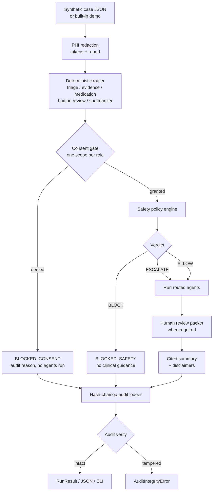

# iEESBots Governance Core

**A multi-agent healthcare prototype where the interesting engineering is not the model call — it is proving the system cannot quietly bypass consent, leak identifiers, invent unsafe medication advice, or rewrite its own audit trail.**

[](https://www.python.org/)
[](#measured-results)
[](#measured-results)
[](#quickstart)
[](LICENSE)
[](#safety-and-ethics)

> **This is a synthetic research prototype, not a medical device.**
> It does not diagnose, prescribe, triage real patients, or provide medical advice.
> It is not HIPAA-, GDPR-, FDA-, or MDR-compliant. Every case, identifier, and
> evidence snippet in this repository is fictional. Do not deploy it in a care
> setting. A licensed clinician must review every escalation.

---

## The hook

Most "multi-agent healthcare" demos stop at a convincing chat transcript. This
repository keeps the original multimodal multi-agent research, then adds the part
that makes a prototype reviewable: a **deterministic governance core** with typed
agent contracts, consent enforcement, PHI redaction, clinical-safety policy,
human-in-the-loop gating, and a tamper-evident audit chain — all offline, with
zero runtime dependencies and a test suite that proves every branch.

The orchestration core makes **no LLM calls**. That is deliberate: probabilistic
reasoning is hard to test, while governance must be boringly reproducible.

---

## The problem

A care-navigation assistant can fail in ways that a demo never shows:

| Failure mode | Why it matters | Control in this repo |
|---|---|---|
| An agent runs before consent is verified | Privacy and authorization breach | Consent gate runs before any agent; deterministic denial + audit reason |
| PHI appears in logs, summaries, or evidence | Re-identification and compliance risk | Regex redaction with stable tokens and an in-memory vault |
| The system gives medication advice despite an allergy | Direct patient harm | Allergy-family rule returns a hard `BLOCK` |
| A red-flag symptom is summarized as routine | Delayed emergency care | Red-flag rules force `ESCALATE` and a human-review packet |
| A high-risk case is auto-finalized | Automation bias | Policy verdict is computed before summarization; human review is explicit |
| An audit log is edited after the fact | No accountability | SHA-256 hash chain detects edits and broken links |
| Routing changes between runs | Impossible to reproduce an incident | Pure, precedence-ordered router with recorded rationale |

The original research explored multimodal routing (text, image, speech) with
CrewAI, Groq, Ollama, Replicate, and RAG. This upgrade preserves those notebooks
and asks the next engineering question: **what would it take to govern that kind
of system?**

---

## What this repository demonstrates

- **Typed inter-agent contracts** — triage, evidence, medication, human review,
  and summarizer messages are dataclasses with explicit payload schemas.
- **Deterministic routing** — structured flags select agents in a documented
  precedence order; every selection carries a rationale.
- **Least-privilege consent** — each role requires one explicit scope; a missing
  scope halts the run before any agent processes the case.
- **PHI redaction** — MRN, SSN, phone, email, and date patterns with reversible
  tokenization into a local vault, plus a per-category report.
- **Clinical safety policy** — red flags, allergy conflicts, missing evidence,
  polypharmacy, pediatric, and pregnancy rules with `BLOCK > ESCALATE > ALLOW`
  precedence and a mandatory human-review flag.
- **Hash-chained audit ledger** — every orchestration and agent decision is
  appended with a digest linked to the previous entry.
- **Cited summaries** — structured sections cite synthetic evidence IDs and
  policy rule IDs, with repeated non-medical-device disclaimers.
- **A real CLI** — `python -m ieesbots --demo`, `--json`, and `--case file.json`.
- **Rigorous tests** — 133 tests, 100% line and branch coverage of the package.

---

## Governance architecture



**Execution order is a safety property.** PHI is redacted before routing; consent
is checked before policy and agents; policy is evaluated before any summary;
blocked runs never invoke agents; the audit ledger is verified before a result is
returned.

More detail: [ARCHITECTURE.md](ARCHITECTURE.md) ·
[Design decisions](docs/DESIGN_DECISIONS.md) ·
[Safety and ethics](docs/SAFETY_AND_ETHICS.md).

---

## Repository map

| Path | Purpose |
|---|---|
| `ieesbots/` | **New dependency-free governance core** (models, router, consent, redaction, policy, audit, orchestrator, CLI) |
| `tests/test_ieesbots.py` | 133-test suite covering every public function and branch |
| `examples/synthetic_case.json` | Fictional case file usable with `--case` |
| `docs/` | Design decisions and safety/ethics analysis |
| `ARCHITECTURE.md`, `TESTING.md` | System and verification documentation |
| `pyproject.toml` | Package metadata, pytest config, coverage gate |
| `Makefile` | `test`, `coverage`, `demo`, `clean` shortcuts |
| `.github/workflows/ci.yml` | Python 3.10–3.12 matrix with a 100% coverage gate |
| `src/`, `research/`, `config/`, `data/` | **Preserved original research archive** (notebooks, PDFs, images, placeholder app files) |
| `test/` | **Preserved legacy tests**, excluded from the default run — see [TESTING.md](TESTING.md) |

The original notebooks (`src/Multi-Agent-Healthcare-iEESBots.ipynb`,
`research/agentic_RAG_with_ollama.ipynb`, `research/model_test.ipynb`), the
attention paper PDF, images, configuration, and license are untouched.

---

## Quickstart

Requirements: **Python 3.10+** and nothing else for the governance core.

```bash
git clone https://github.com/MrKyaw/Multi-Agent-Healthcare-iEESBots-Multimodal-.git
cd Multi-Agent-Healthcare-iEESBots-Multimodal-

python3 -m ieesbots --demo
python3 -m ieesbots --demo --json
python3 -m ieesbots --help
```

No install, API key, environment variable, model download, database, or network
connection is required. To install the console script and dev tooling:

```bash
python3 -m venv .venv
source .venv/bin/activate
pip install -e ".[dev]"
ieesbots --demo
```

### CLI examples

```bash
# Built-in fictional high-acuity case (chest pain + polypharmacy)
$ python3 -m ieesbots --demo

iEESBots synthetic run — SYN-1001
Status: awaiting_human_review
Human review required: True
Policy verdict: escalate
PHI tokens: 4 (date=1, email=1, mrn=1, phone=1)
Routing:
  - Triage (priority 10)
  - Evidence (priority 20)
  - Medication (priority 30)
  - Human Review (priority 40)
  - Summarizer (priority 90)
...
Audit entries: 9
Audit chain: intact
```

```bash
# Machine-readable run, including redacted narrative and the full audit chain
$ python3 -m ieesbots --demo --json > run.json

# Run your own synthetic case
$ python3 -m ieesbots --case examples/synthetic_case.json
```

Exit codes: `0` completed or awaiting human review, `1` blocked by consent or
safety policy, `2` invalid input.

### Case JSON

```json
{
  "case_id": "SYN-2001",
  "narrative": "Synthetic patient with chest pain. MRN: 1234567.",
  "age": 58,
  "symptoms": ["chest pain", "shortness of breath"],
  "medications": ["aspirin", "metoprolol"],
  "allergies": ["penicillin"],
  "flags": {
    "chest_pain": true,
    "polypharmacy": false,
    "imaging_available": true
  },
  "consent": [
    "care.triage",
    "evidence.retrieve",
    "medication.review",
    "human.review",
    "summary.generate"
  ],
  "evidence": [
    {
      "evidence_id": "EV-100",
      "title": "Synthetic checklist",
      "source": "Fictional fixture — not a guideline",
      "text": "Synthetic text requiring clinician review.",
      "kind": "checklist"
    }
  ]
}
```

Unknown fields in `flags` are rejected; unknown consent scopes are rejected. There
is intentionally **no external evidence fetch**.

---

## Measured results

Recorded locally on **Python 3.12.8, macOS**, at the time of this upgrade.

```text
$ python3 -m pytest -q
133 passed in 0.44s
```

```text
$ python3 -m pytest --cov=ieesbots --cov-branch --cov-report=term-missing

Name                         Stmts   Miss Branch BrPart    Cover
-----------------------------------------------------------------
ieesbots/__init__.py            16      0      0      0  100.00%
ieesbots/__main__.py             4      0      2      0  100.00%
ieesbots/agents.py              97      0     28      0  100.00%
ieesbots/audit.py               48      0      8      0  100.00%
ieesbots/casefile.py            51      0     16      0  100.00%
ieesbots/cli.py                 42      0      8      0  100.00%
ieesbots/clinical_rules.py      38      0     18      0  100.00%
ieesbots/consent.py             21      0      2      0  100.00%
ieesbots/contracts.py           57      0      0      0  100.00%
ieesbots/exceptions.py          17      0      0      0  100.00%
ieesbots/models.py             178      0     10      0  100.00%
ieesbots/orchestrator.py        79      0     10      0  100.00%
ieesbots/policy.py              28      0     16      0  100.00%
ieesbots/redaction.py           62      0      6      0  100.00%
ieesbots/router.py              55      0     28      0  100.00%
-----------------------------------------------------------------
TOTAL                          793      0    152      0  100.00%
Required test coverage of 100.0% reached.
```

The coverage gate is enforced by `fail_under = 100` in `pyproject.toml`. The CI
workflow is configured for Python 3.10, 3.11, and 3.12; only 3.12.8 was available
on the authoring machine, so no local claim is made for the other versions.

**What is not measured:** clinical accuracy, diagnostic performance, safety in
real use, throughput, latency, or regulatory compliance. None of those are
claimed. See [TESTING.md](TESTING.md) for the honest scope.

---

## Engineering decisions

1. **Determinism over model magic in the core.** Every route, verdict, token, and
   audit hash is reproducible. The LLM is an optional presentation layer, not the
   safety boundary.
2. **Consent before compute.** The consent gate runs before policy evaluation and
   before any agent. A denial is a first-class result (`BLOCKED_CONSENT`) with an
   audit reason, not an exception that might be swallowed.
3. **Fail closed on medication conflicts.** Allergy conflicts produce `BLOCK`, not
   a warning. Red flags and missing evidence produce `ESCALATE`, never `ALLOW`.
4. **Policy precedence is explicit.** `BLOCK > ESCALATE > ALLOW`, so a high-risk
   finding cannot be averaged away by benign ones.
5. **Typed contracts, not dictionaries.** Each agent payload is a frozen dataclass;
   serialization is explicit and testable.
6. **PHI is redacted at the boundary.** The reversible vault is process-local and
   in memory; summaries and JSON contain only tokens and counts.
7. **The audit chain commits to content, not just events.** Editing details,
   changing an index, or swapping a previous hash breaks verification.
8. **Zero runtime dependencies.** Standard library only: portable, auditable, and
   usable in restricted environments.
9. **No fabricated evidence.** All evidence text is labeled fictional; citations
   point to fixture IDs and policy rules, not invented clinical literature.
10. **Honest legacy boundary.** Old `test/` files are preserved but excluded from
    the default run because they target the original external-service app.

More context and trade-offs: [docs/DESIGN_DECISIONS.md](docs/DESIGN_DECISIONS.md).

---

## Original multimodal research vs. new core

| Layer | Original archive | New governance core |
|---|---|---|
| Inputs | Text, images, speech, PDFs | Synthetic structured case + narrative |
| Agents | CrewAI agents with Groq/Ollama/Replicate | Deterministic Python roles |
| Routing | LLM router prompt | Pure precedence router |
| Dependencies | LangChain, CrewAI, external APIs | Python standard library only |
| Runtime | Network + API keys | Offline |
| Testing | Notebook demonstrations | 133 tests, 100% line+branch |
| Safety | Not enforced | Consent, PHI, policy, human gate, audit |

**Live CrewAI/Ollama is optional and not part of the tested runtime.** The
`[project.optional-dependencies].live` extra lists candidate packages, but the
orchestrator never imports them. An adapter would sit *behind* the typed agent
contracts; governance checks would still run first. The notebooks remain the
record of the original multimodal experiments and may require API keys and network
access to execute.

---

## Safety and ethics (read this)

- **Not a medical device.** No diagnosis, treatment, prescription, or triage
  recommendation is produced.
- **Synthetic data only.** Demo identifiers (`MRN: 8891234`, phone, email) are
  fictional. No real patient data is included, and the CLI performs no network I/O.
- **Rules are illustrative.** Red-flag terms, allergy families, and polypharmacy
  thresholds are small, blunt tables for demonstration — not clinical knowledge.
- **Redaction is not de-identification.** Regexes miss names, addresses, free-text
  identifiers, and context. The in-memory vault is a testing mechanism, not a
  compliant secrets store.
- **The audit chain is not WORM storage.** It detects edits within one process; it
  does not prevent deletion of the whole ledger or provide non-repudiation.
- **Human oversight is mandatory for every escalation.** The summary is a draft
  artifact for a licensed reviewer, never an action.
- **Automation bias and equity risks remain.** Keyword rules can under-trigger for
  atypical presentations and over-trigger for some populations. No fairness or
  clinical validation has been performed.
- **No regulatory claims.** This is not HIPAA, GDPR, FDA, or MDR compliant.

Full threat model and residual risks: [docs/SAFETY_AND_ETHICS.md](docs/SAFETY_AND_ETHICS.md).

---

## Reviewer snapshot

**What this project shows**

| Signal | Evidence |
|---|---|
| Production-minded Python | Typed dataclasses, custom exceptions, package layout, no global state |
| AI safety & governance | Consent gating, PHI redaction, policy precedence, human-in-the-loop, audit chain |
| Test engineering | 133 tests, 100% line **and** branch coverage, CLI and failure-path tests |
| Systems thinking | Explicit control ordering, deterministic routing, threat model, documented trade-offs |
| Communication | Architecture diagrams, ADRs, honest limitations, reproducible commands |
| Healthcare domain awareness | Red flags, allergy conflicts, polypharmacy, pediatric/pregnancy escalation |

**30-second tour**

```bash
python3 -m pytest -q
python3 -m ieesbots --demo
```

Then read `ieesbots/orchestrator.py` (control order), `ieesbots/policy.py` (safety
precedence), and `docs/SAFETY_AND_ETHICS.md` (what it refuses to claim).

**Role fit:** AI/ML engineering, applied AI safety, healthcare data engineering,
platform engineering, backend Python, clinical informatics tooling.

---

## Author

**Kyaw Kyaw Oo**
[kyaw.tech@gmail.com](mailto:kyaw.tech@gmail.com) ·
[github.com/MrKyaw](https://github.com/MrKyaw)

License: [MIT](LICENSE). The original research archive remains under the same
license; see the preserved notebooks for their original context.


⭐ Star this repo if you find it useful!

Report Bug · Request Feature · Ask Question
